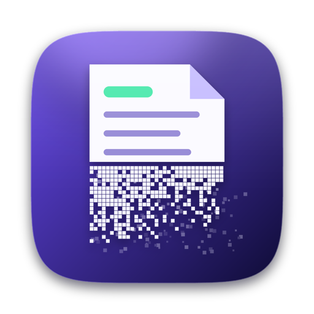
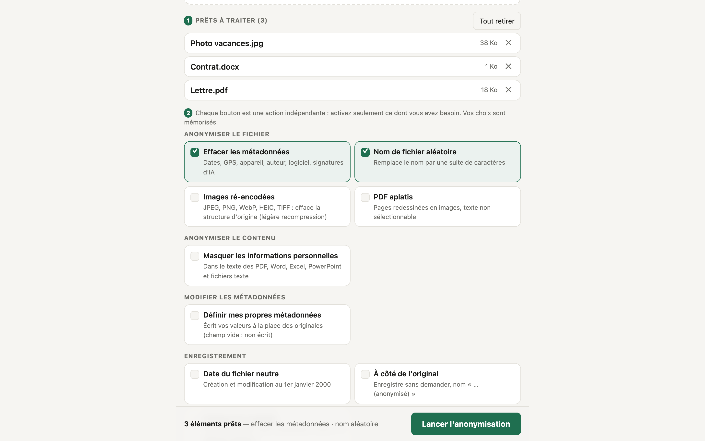
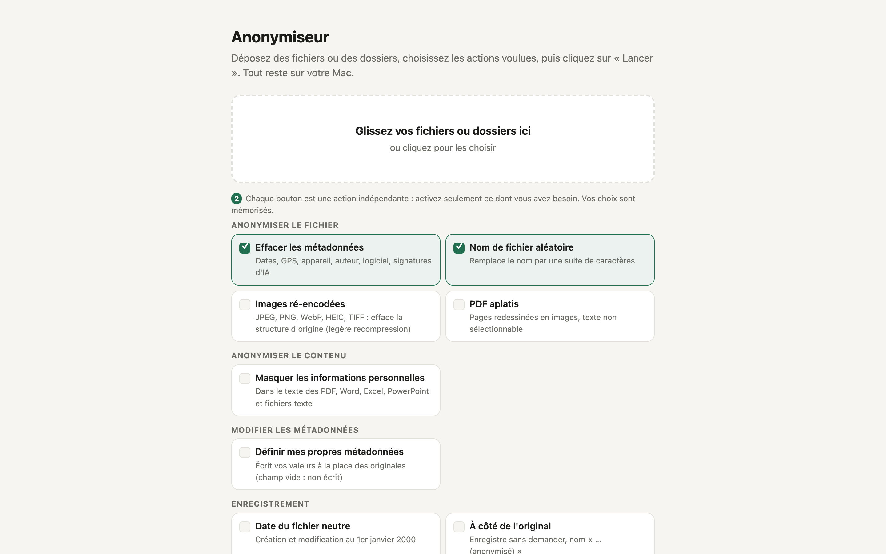
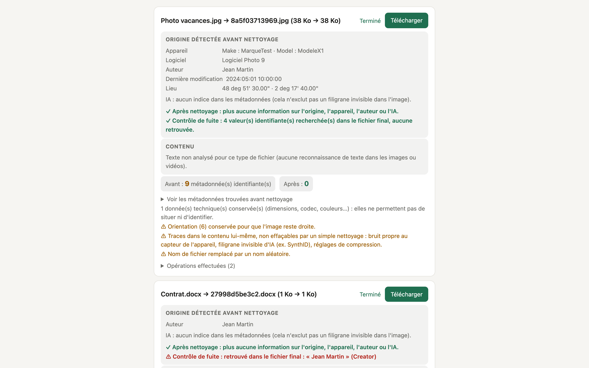
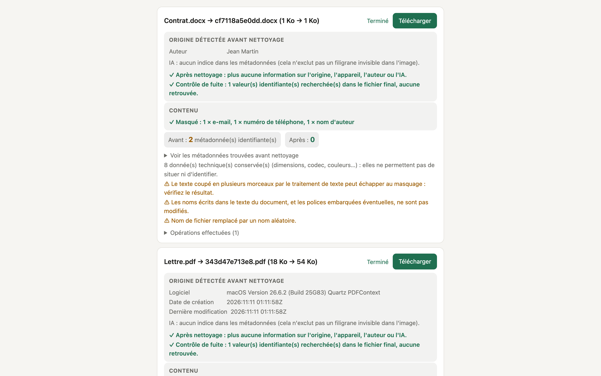
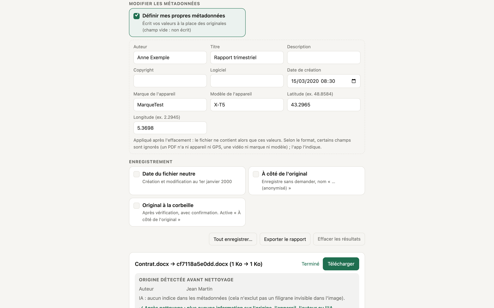
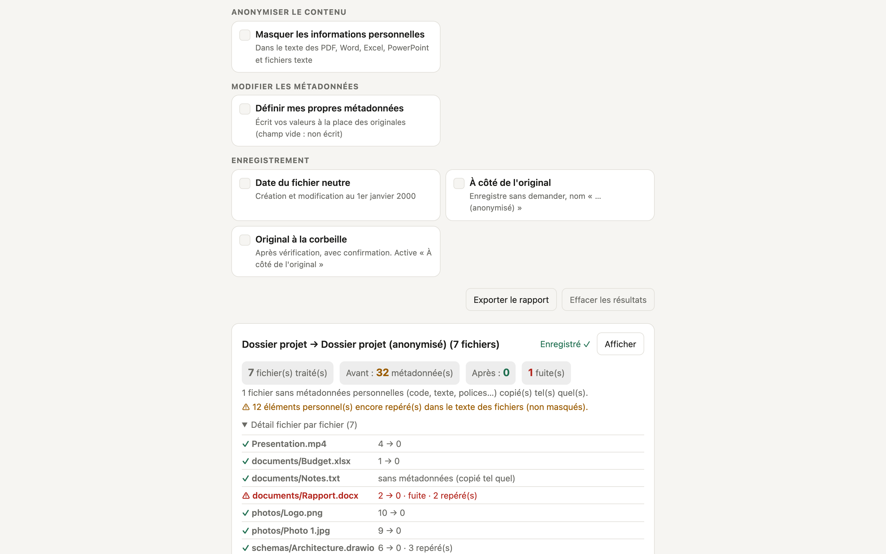
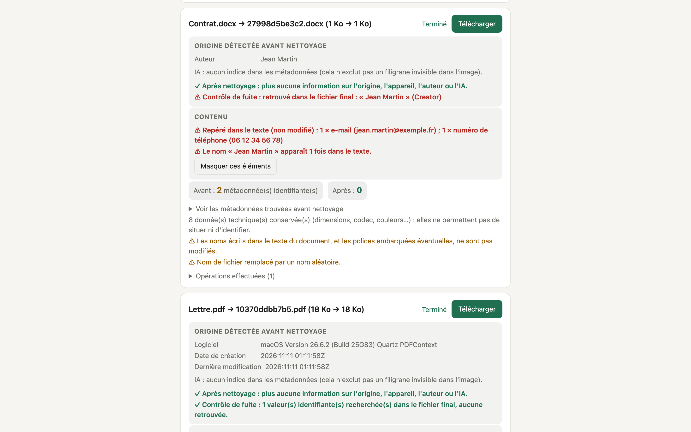
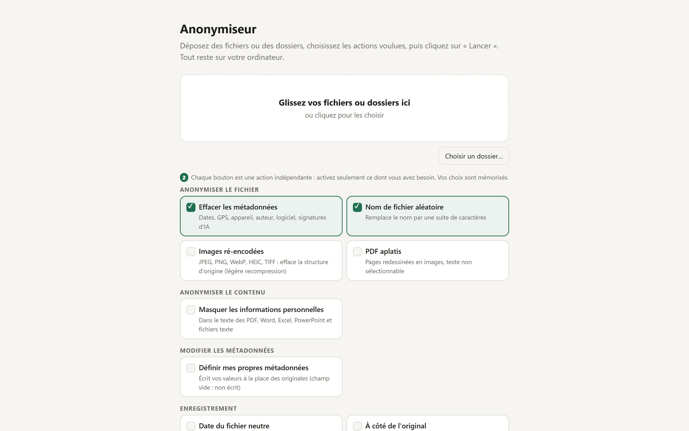

<div align="center">



# Anonymiseur

**Strip the metadata from your files, and mask what they contain, without sending anything over the Internet.**

[](LICENSE)
-1f6f50)
-1f6f50)


[Version française](README.md) · [Download](../../releases/latest)



</div>

> The app interface is in French. / L'interface de l'application est en français.

## What it does

A photo, a PDF or a Word document holds far more than what you see: **where and when** it was made, **with which device
and software**, **by whom**, sometimes **with which AI**. Anonymiseur removes those traces, checks that none are left,
and shows you exactly what it found.

- **Erases metadata**: dates, GPS position, device, author, software, thumbnails, AI signatures (C2PA, Stable
  Diffusion/ComfyUI generation prompts…), editing identifiers, comment authors' names.
- **Shows the "detected origin"** before cleaning (device, software, author, place, AI hints) and confirms nothing is left
  afterwards.
- **Leak check**: searches the final file for every name or serial number that was in it before. If one comes back, it is
  shown in red.
- **Masks the content** (separate button): e-mails, phone numbers, IBANs, bank cards, social security numbers, paths, IP
  addresses, authors' names and your own words, inside the text of PDF, Word, Excel, PowerPoint, draw.io, SVG and plain
  text or code files.
- **Sets your own metadata** (separate button): author, title, date, GPS location, device, software of your choice.
- **Every action is an independent button**: anonymize the file without touching its content, or the opposite, or both.
  Your choices are remembered.
- **You stay in control**: drop files, pick actions, then click **"Lancer"** (Launch). Nothing starts by itself.
- **Folders and archives** (ZIP, tar.gz): processed file by file, structure kept.
- **Originals are never modified**: the result is always a copy.

### Supported formats

| Family | Formats |
|---|---|
| Images | JPEG, PNG, WebP, GIF, TIFF, HEIC, PSD (Photoshop) |
| Documents | PDF, Word, Excel, PowerPoint, OpenDocument (ODT/ODS/ODP) |
| Drawing | draw.io (`.drawio`, `.dio`, `.drawio.svg`, `.drawio.png`), SVG (Inkscape, Illustrator) |
| Audio / video | MP4, MOV, MKV, AVI, MP3, M4A, WAV, FLAC, OGG… |
| Archives | ZIP, TAR, GZ, TGZ |
| Web / text | HTML, `.po` translation files, text and code (content masking only) |

Code, text files and fonts carry no personal metadata: they are copied as-is (in folders) or reported as "no metadata".

## Screenshots

| | |
|---|---|
|  |  |
| **Home**: drop, choose, launch. | **Result**: detected origin, leak check, before/after. |
|  |  |
| **Content masked** in a Word document. | **Your own metadata** in place of the originals. |
|  |  |
| **A whole folder**, file by file. | An **author's name** left in the text is flagged. |
|  | |
| **On Windows**: automatic screenshot of the installed app (Edge), taken on GitHub's servers. | |

*All the data shown is fictitious (see `examples/`). Screenshots taken on a Mac; the interface is the same on Windows.*

## Installation

### Mac (Apple Silicon)

1. Download `Anonymiseur-1.1-arm64.dmg` from the [releases page](../../releases/latest).
2. Open the `.dmg` and **drag Anonymiseur into Applications**.
3. **First launch**: the app is ad-hoc signed but **not notarized by Apple** (that requires a paid developer account), so
   macOS blocks it the first time:
   - **right-click** Anonymiseur → **Open** → **Open**; or
   - in Terminal: `xattr -dr com.apple.quarantine /Applications/Anonymiseur.app`

### Windows 10 / 11 (64-bit)

1. Download `Anonymiseur-1.1-x64-setup.exe` from the [releases page](../../releases/latest) and run it.
2. **SmartScreen warning**: the installer is **not signed** (a signing certificate is paid). Windows shows "Windows
   protected your PC": click **More info**, then **Run anyway**.
3. Follow the wizard (installing **without administrator rights** is possible: the wizard offers the choice). You can add a Desktop shortcut and the
   **Send to → Anonymiseur** right-click entry. To uninstall: *Settings → Apps*.

The app opens in an Edge window without an address bar (Edge ships with Windows; otherwise Chrome or your default browser
is used). The installer is French.

**Nothing else to install** on either system: Python, FFmpeg and ExifTool are bundled (≈ 105 MB on Mac, 42 MB installer on
Windows). No Internet connection is needed; the engine only listens on `127.0.0.1` and contacts no server.

You can verify a download with the SHA-256 shown on the release page (`shasum -a 256 <file>` on Mac,
`Get-FileHash <file>` on Windows).

## Getting started

1. **Drop** files into the window (or click to pick them). On Mac you can also drop folders, or right-click → *Open With* →
   Anonymiseur. On Windows use **"Choisir un dossier…"** (choose a folder), or right-click a file → **Send to →
   Anonymiseur**. They appear under "Prêts à traiter" (ready to process).
2. **Pick the actions** (buttons): erase metadata, random file name, mask content, etc.
3. Click **"Lancer l'anonymisation"**, then **Télécharger** each result (or **Tout enregistrer…** to save them all).

Fictitious sample files are in [`examples/`](examples).

## Compatibility and known limits

**What was tested**

- **Mac**: Apple Silicon running **macOS 26.6.2**. The app's engine was run **without Homebrew** (a `sandbox-exec` profile
  forbidding `/opt/homebrew` and `/usr/local`) and passed the test suite (32 test files × 5 option combinations, i.e. 711
  checks, `tests/run_tests.py`). Opening files from the Finder (queued without automatic processing) was tried in the real
  window.
- **Windows**: on GitHub's servers (`windows-latest`, see `.github/workflows/windows.yml`), on every change: installer
  build, **711 checks** of the bundled engine, then a **silent install** (into a folder with spaces and an apostrophe), app
  launch, **707 checks** against the installed app, tests of the recycle bin, "Tout enregistrer", the "Send to" queue,
  creation dates and paths with accents, an Edge window opening, a screenshot of the interface, and a clean uninstall.

**What was not tested**

- **Mac**: another Mac or another macOS version (the **macOS 12** minimum is computed from the bundled binaries but was not
  verified on a machine running macOS 12 to 15); the first launch with Gatekeeper quarantine; with the mouse, in the window:
  drag-and-drop, "Tout enregistrer…", "Original à la corbeille" (move to Trash), report export. **Intel Macs** are not
  supported.
- **Windows**: a real PC used by a person (the tests run without human clicks, and the file dialogs are simulated);
  **Windows 10** and **Windows on ARM**; the SmartScreen prompt; a Windows without Edge.

**Windows-specific limits**

- The **"Images ré-encodées" (re-encoded images) mode is not available for HEIC** (the HEIC decoder contains GPL-licensed
  code, incompatible with the project's MIT license). The app then applies standard cleaning, which does erase the metadata.
- You cannot **drag a folder** into the window: use "Choisir un dossier…".
- Files dragged into the window are handled as in a browser (they download). "À côté de l'original" (next to the original)
  and "Original à la corbeille" need files chosen with the button, "Send to", or a folder.

**Cleaning limits (please read)**

- Some traces are **in the content itself** and cannot be erased: a camera sensor's own noise, invisible AI watermarks
  (e.g. SynthID), writing style. The "re-encoded images" mode erases the file structure but not those traces.
- Text **visible inside an image or video** is not read (no text recognition), so it is not masked.
- **MKV**: the library itself writes an `encoder=Lavf` marker that cannot be removed.
- **PSD**: each layer's modification date is kept (removing it could corrupt the file).
- **Word / Excel**: an e-mail split into several pieces by the word processor may escape masking.
- **Folders**: file and folder names are kept so the structure stays intact.
- **Unsupported formats**: Affinity (`.afpub`…), InDesign, Sketch, password-protected ZIP. The app says so; export to PDF or
  an image first, then anonymize the export.
- Anonymizing does not guarantee anonymity: the text of a document, a face or a recognizable place in a photo remain.

## Build from source

**Mac**: an Apple Silicon Mac, the **Xcode command line tools** (`xcode-select --install`), and **ExifTool** for the build
only (`brew install exiftool`). An Internet connection is needed the first time.

```bash
./build_app.sh            # downloads and verifies components (SHA-256), builds a minimal FFmpeg, builds dist/Anonymiseur.app
./make_dmg.sh             # builds dist/Anonymiseur-1.1-arm64.dmg and its SHA-256 checksum
./build_app.sh --install  # alternative: build, then install into /Applications
```

**Windows**: the easiest way is to let **GitHub Actions** build it (*Actions* tab → *Windows*, the installer is the
artifact). Locally: Windows 10/11, PowerShell 7, MSYS2 and Inno Setup 6, then `./windows/build_windows.ps1 -Version 1.1`
(downloads and verifies the components, builds FFmpeg, assembles and builds `dist\Anonymiseur-1.1-x64-setup.exe`).

The scripts check that no personal path from your machine ends up inside the app (Mac).

## Code layout

```
src/cleaners.py     engine: cleaning, masking, inspection, leak check (shared by Mac and Windows)
src/server.py       small local server (127.0.0.1) between the window and the engine (shared)
src/index.html      interface (French, light theme) (shared)
src/main.swift      Mac: macOS window (WebKit); launches the bundled engine
src/pdfflat.swift   Mac: tool that redraws and blacks out PDFs (PDFKit)
windows/            Windows: launcher (Edge window), build, FFmpeg, Inno Setup installer, end-to-end tests
scripts/            Mac: verified download of components, FFmpeg build, screenshots
tests/              fake test-file generator and test suite (Mac and Windows)
examples/           fictitious sample files
build_app.sh        Mac: builds the standalone app ;  make_dmg.sh: builds the .dmg
.github/workflows/  automatic build and tests on Windows
```

## Tests

```bash
.deps/python/bin/python3 tests/run_tests.py          # Mac, after a first ./build_app.sh
.\dist\Anonymiseur\python\python.exe tests\run_tests.py    # Windows, after windows\build_windows.ps1
```

The test fails if a required test file is missing, so it can never "pass" by testing nothing.

## Contributing

Reports of badly handled formats and proposals (issues, pull requests) are welcome. Run the tests above before sending a
change (they also run automatically on Windows). **Never add real files or personal data** to the repository: use
fictitious data.

## License

[MIT](LICENSE) © 2026 Wudstyz. Bundled components have their own licenses: see
[`THIRD_PARTY_NOTICES.md`](THIRD_PARTY_NOTICES.md). Trademarks mentioned belong to their owners; this project is not
affiliated with any of these companies.
