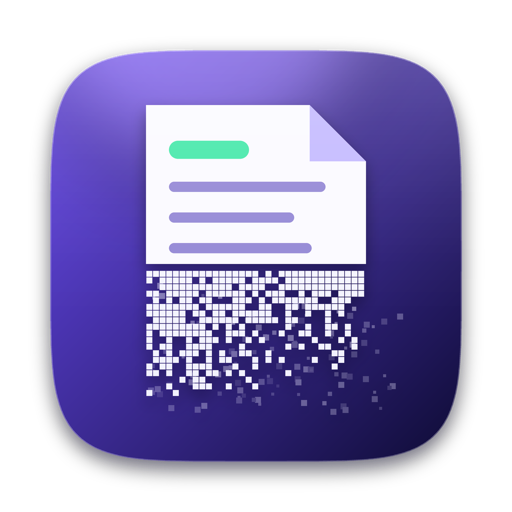
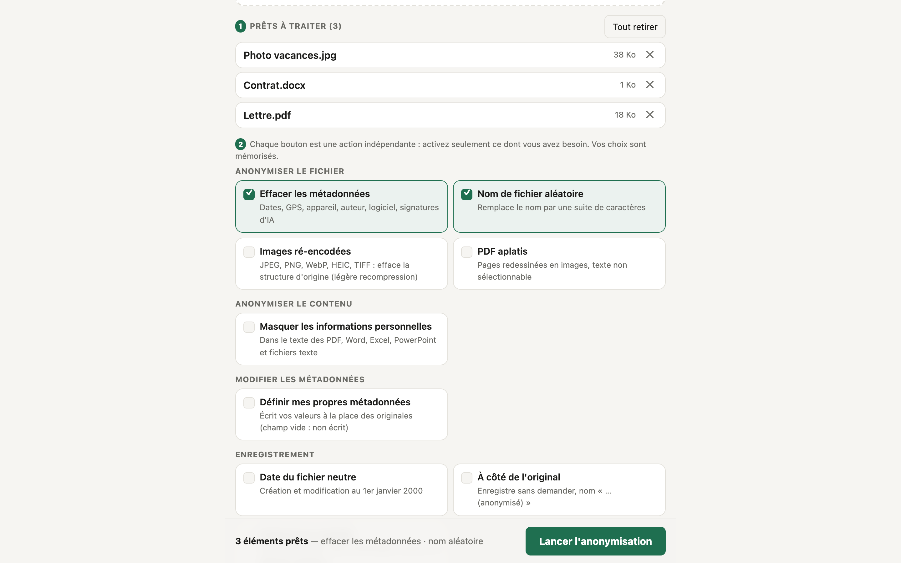
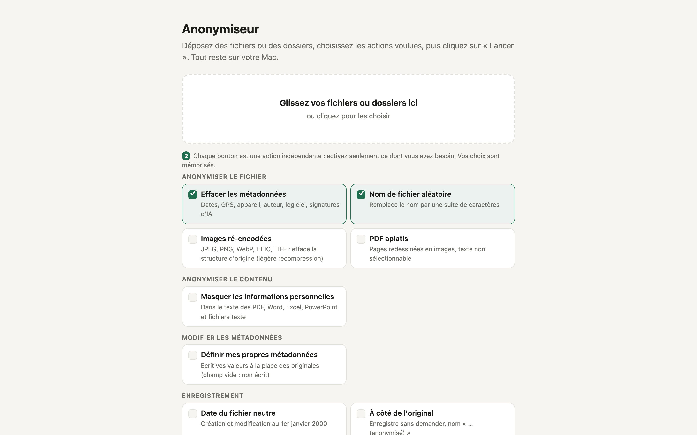
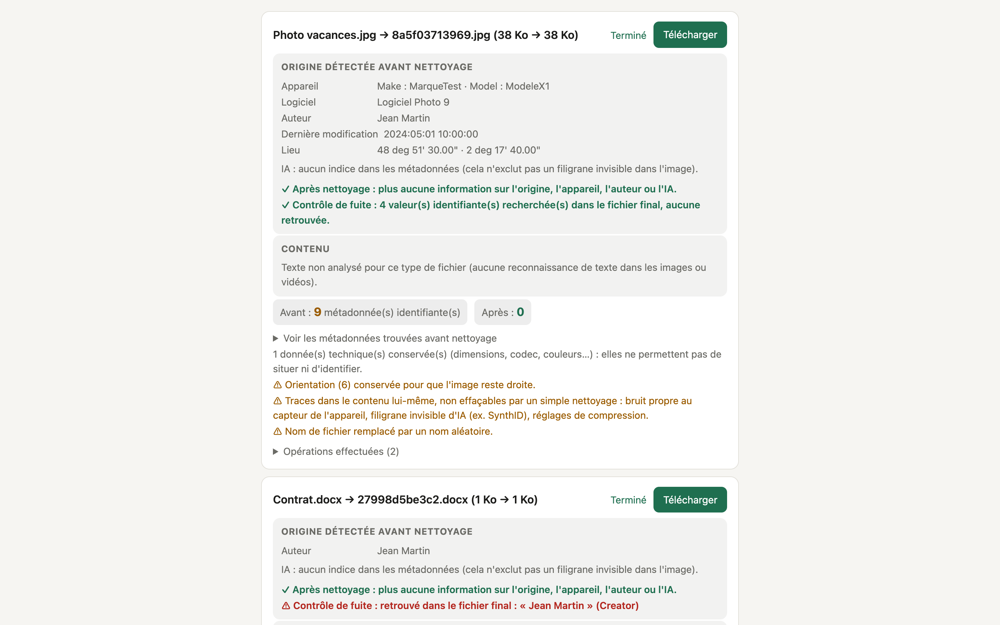
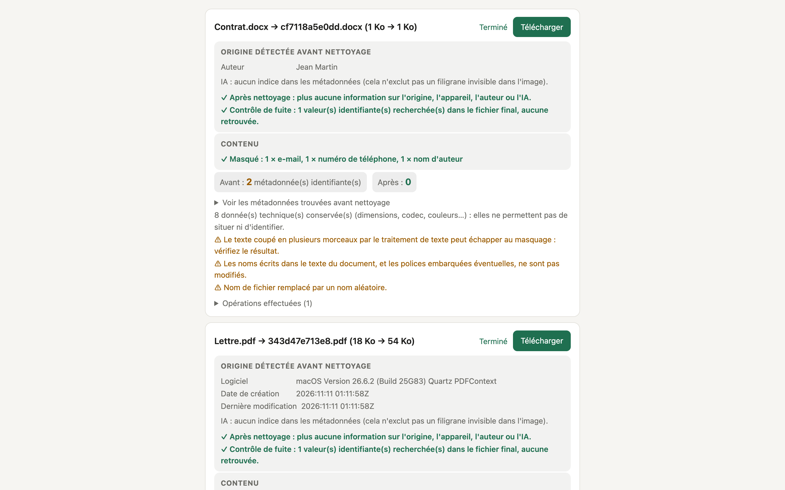
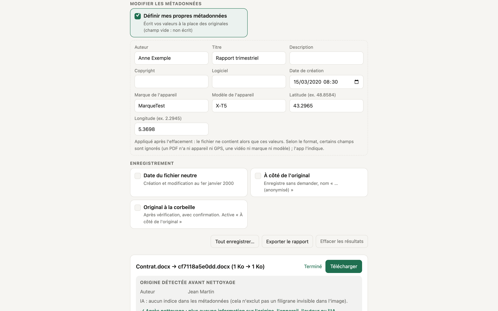
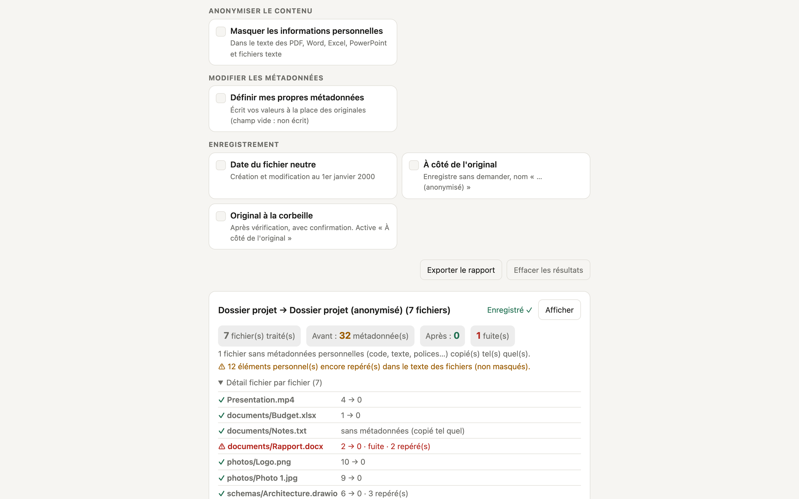
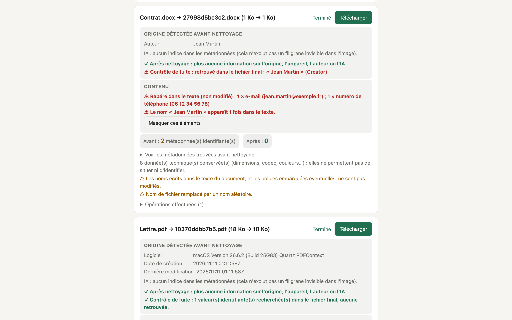
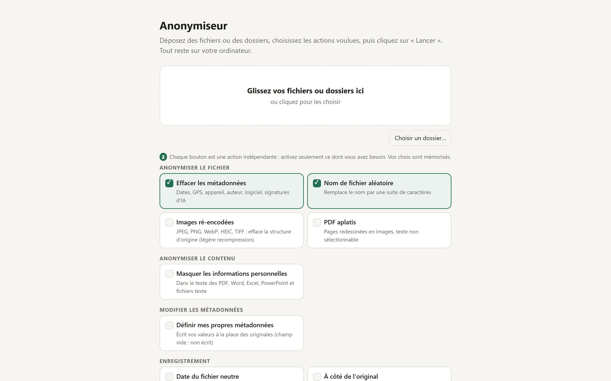

<div align="center">



# Anonymiseur

**Effacez les métadonnées de vos fichiers, et masquez ce qu'ils contiennent, sans rien envoyer sur Internet.**

[](LICENSE)
-1f6f50)
-1f6f50)


[English version](README.en.md) · [Télécharger](../../releases/latest)



</div>

## Ce que ça fait

Une photo, un PDF ou un document Word contient bien plus que ce que l'on voit : **où et quand** il a été créé, **avec quel
appareil et quel logiciel**, **par qui**, parfois **avec quelle IA**. Anonymiseur retire ces traces, vérifie qu'il n'en reste
pas, et vous montre exactement ce qui a été trouvé.

- **Efface les métadonnées** : dates, position GPS, appareil, auteur, logiciel, miniatures, signatures d'IA (C2PA, invites
  de génération Stable Diffusion/ComfyUI…), identifiants d'édition, noms des auteurs de commentaires.
- **Montre l'« origine détectée »** avant nettoyage (appareil, logiciel, auteur, lieu, indices d'IA) et confirme qu'il n'en
  reste rien après.
- **Contrôle de fuite** : cherche dans le fichier final chaque nom ou numéro de série qui figurait avant. Si l'un
  réapparaît, vous le voyez en rouge.
- **Masque le contenu** (bouton à part) : e-mails, téléphones, IBAN, cartes bancaires, n° de sécurité sociale, chemins,
  adresses IP, noms des auteurs et vos propres mots, dans le texte des PDF, Word, Excel, PowerPoint, draw.io, SVG et
  fichiers texte ou code.
- **Définit vos propres métadonnées** (bouton à part) : auteur, titre, date, lieu GPS, appareil, logiciel de votre choix.
- **Chaque action est un bouton indépendant** : anonymiser le fichier sans toucher au contenu, ou l'inverse, ou les deux.
  Vos choix sont mémorisés.
- **Vous gardez la main** : on dépose les fichiers, on choisit les actions, puis on clique sur **« Lancer »**. Rien ne
  démarre tout seul.
- **Dossiers et archives** (ZIP, tar.gz) : traités fichier par fichier, arborescence conservée.
- **Les originaux ne sont jamais modifiés** : le résultat est toujours une copie.

### Formats pris en charge

| Famille | Formats |
|---|---|
| Images | JPEG, PNG, WebP, GIF, TIFF, HEIC, PSD (Photoshop) |
| Documents | PDF, Word, Excel, PowerPoint, OpenDocument (ODT/ODS/ODP) |
| Dessin | draw.io (`.drawio`, `.dio`, `.drawio.svg`, `.drawio.png`), SVG (Inkscape, Illustrator) |
| Audio / vidéo | MP4, MOV, MKV, AVI, MP3, M4A, WAV, FLAC, OGG… |
| Archives | ZIP, TAR, GZ, TGZ |
| Web / texte | HTML, fichiers de traduction `.po`, texte et code (masquage du contenu seulement) |

Les fichiers de code, de texte et les polices ne contiennent pas de métadonnées personnelles : ils sont copiés tels quels
(en dossier) ou signalés « Sans métadonnées ».

## Captures d'écran

| | |
|---|---|
|  |  |
| **Accueil** : déposez, choisissez, lancez. | **Résultat** : origine détectée, contrôle de fuite, avant/après. |
|  |  |
| **Contenu masqué** dans un document Word. | **Vos propres métadonnées** à la place des originales. |
|  |  |
| **Un dossier entier**, fichier par fichier. | Un **nom d'auteur** resté dans le texte est signalé. |
|  | |
| **Sous Windows** : capture automatique de l'app installée (Edge), prise sur les serveurs de GitHub. | |

*Toutes les données visibles sont fictives (voir `examples/`). Captures prises sur Mac ; l'interface est la même sous Windows.*

## Installation

### Mac (Apple Silicon)

1. Téléchargez `Anonymiseur-1.1-arm64.dmg` depuis la [page des versions](../../releases/latest).
2. Ouvrez le `.dmg` et **glissez Anonymiseur dans Applications**.
3. **Première ouverture** : l'app est signée « ad hoc » mais **pas notarisée par Apple** (cela demande un compte
   développeur payant). macOS la bloque donc au premier lancement :
   - **clic droit** sur Anonymiseur → **Ouvrir** → **Ouvrir** ; ou
   - dans le Terminal : `xattr -dr com.apple.quarantine /Applications/Anonymiseur.app`

### Windows 10 / 11 (64 bits)

1. Téléchargez `Anonymiseur-1.1-x64-setup.exe` depuis la [page des versions](../../releases/latest) et lancez-le.
2. **Avertissement SmartScreen** : l'installateur n'est **pas signé** (un certificat de signature est payant). Windows
   affiche « Windows a protégé votre PC » : cliquez sur **Informations complémentaires**, puis **Exécuter quand même**.
3. Suivez l'assistant (installation possible **sans droits administrateur** : l'assistant vous propose le choix). Vous pouvez ajouter un raccourci sur le
   Bureau et l'entrée **Envoyer vers → Anonymiseur** du clic droit. Pour désinstaller : *Paramètres → Applications*.

L'app s'ouvre dans une fenêtre Edge sans barre d'adresse (Edge est fourni avec Windows ; à défaut, Chrome ou votre
navigateur par défaut est utilisé).

**Rien d'autre à installer** sur les deux systèmes : Python, FFmpeg et ExifTool sont embarqués (≈ 105 Mo sur Mac, 42 Mo
d'installateur sous Windows). Aucune connexion Internet n'est nécessaire : le moteur n'écoute que sur `127.0.0.1` et ne
contacte aucun serveur.

Vous pouvez vérifier un téléchargement avec la somme SHA-256 indiquée dans la page de la version (`shasum -a 256 <fichier>`
sur Mac, `Get-FileHash <fichier>` sous Windows).

## Premiers pas

1. **Déposez** des fichiers dans la fenêtre (ou cliquez pour les choisir). Sur Mac, vous pouvez aussi déposer des dossiers,
   ou faire clic droit → *Ouvrir avec* → Anonymiseur. Sous Windows, utilisez **« Choisir un dossier… »** ou clic droit sur
   un fichier → **Envoyer vers → Anonymiseur**. Ils s'affichent dans « Prêts à traiter ».
2. **Choisissez les actions** (boutons) : effacer les métadonnées, nom aléatoire, masquer le contenu, etc.
3. Cliquez sur **« Lancer l'anonymisation »**, puis **Télécharger** chaque résultat (ou **Tout enregistrer…**).

Des fichiers d'essai fictifs sont dans [`examples/`](examples).

## Compatibilité et limites connues

**Ce qui a été testé**

- **Mac** : Apple Silicon sous **macOS 26.6.2**. Le moteur de l'app a été lancé **sans Homebrew** (profil `sandbox-exec`
  interdisant `/opt/homebrew` et `/usr/local`) et a passé la batterie de tests (32 fichiers de test × 5 combinaisons
  d'options, soit 711 vérifications, `tests/run_tests.py`). L'ouverture de fichiers depuis le Finder (mise en attente sans
  traitement automatique) a été essayée dans la vraie fenêtre.
- **Windows** : sur les serveurs de GitHub (`windows-latest`, voir `.github/workflows/windows.yml`), à chaque modification :
  construction de l'installateur, **711 vérifications** du moteur embarqué, puis **installation silencieuse** (dans un
  dossier avec espaces et apostrophe), lancement de l'app, **707 vérifications** contre l'app installée, tests de la
  corbeille, de « Tout enregistrer », de la file « Envoyer vers », des dates de création et des chemins avec accents,
  ouverture d'une fenêtre Edge, capture d'écran de l'interface, puis désinstallation propre.

**Ce qui n'a pas été testé**

- **Mac** : un autre Mac ou une autre version de macOS (le minimum **macOS 12** est calculé d'après les binaires embarqués,
  pas vérifié sur une machine sous macOS 12 à 15) ; la première ouverture avec la quarantaine de Gatekeeper ; à la souris,
  dans la fenêtre : glisser-déposer, « Tout enregistrer… », « Original à la corbeille », export du rapport. Les **Mac
  Intel** ne sont pas pris en charge.
- **Windows** : un vrai PC par une personne (les tests tournent sans clic humain, les boîtes de dialogue de fichiers sont
  simulées) ; **Windows 10** et **Windows sur ARM** ; l'avertissement SmartScreen ; un Windows sans Edge.

**Limites propres à Windows**

- Le mode **« Images ré-encodées » n'est pas disponible pour le HEIC** (le décodeur HEIC contient du code sous licence GPL,
  incompatible avec la licence MIT). L'app applique alors le nettoyage standard, qui efface bien les métadonnées.
- On ne peut pas **glisser un dossier** dans la fenêtre : utilisez « Choisir un dossier… ».
- Des fichiers glissés dans la fenêtre sont traités comme dans un navigateur (ils se téléchargent). « À côté de l'original »
  et « Original à la corbeille » demandent de choisir les fichiers par le bouton, « Envoyer vers » ou un dossier.

**Limites du nettoyage (à connaître)**

- Certaines traces sont **dans le contenu lui-même** et ne s'effacent pas : bruit propre au capteur d'un appareil photo,
  filigranes invisibles d'IA (par exemple SynthID), style d'écriture. Le mode « Images ré-encodées » efface la structure du
  fichier mais pas ces traces.
- Le texte **visible dans une image ou une vidéo** n'est pas lu (pas de reconnaissance de texte) : il n'est pas masqué.
- **MKV** : la bibliothèque écrit elle-même un marqueur `encoder=Lavf` qui ne peut pas être retiré.
- **PSD** : la date de modification de chaque calque est conservée (la retirer risquerait d'abîmer le fichier).
- **Word / Excel** : un e-mail coupé en plusieurs morceaux par le traitement de texte peut échapper au masquage.
- **Dossiers** : les noms de fichiers et de dossiers sont conservés pour garder l'arborescence.
- **Formats non pris en charge** : Affinity (`.afpub`…), InDesign, Sketch, ZIP protégé par mot de passe. L'app l'indique ;
  exportez en PDF ou en image puis anonymisez l'export.
- Anonymiser ne garantit pas l'anonymat : le texte d'un document, un visage ou un lieu reconnaissable dans une photo restent.

## Construire depuis les sources

**Mac** : un Mac Apple Silicon, les **outils en ligne de commande Xcode** (`xcode-select --install`), et **ExifTool** pour
la construction seulement (`brew install exiftool`). Une connexion Internet est nécessaire la première fois.

```bash
./build_app.sh            # télécharge et vérifie les composants (SHA-256), compile FFmpeg minimal, construit dist/Anonymiseur.app
./make_dmg.sh             # fabrique dist/Anonymiseur-1.1-arm64.dmg et son empreinte SHA-256
./build_app.sh --install  # variante : construit puis installe dans /Applications
```

**Windows** : le plus simple est de laisser **GitHub Actions** le construire (onglet *Actions* → *Windows*, l'installateur est
l'artefact). En local : Windows 10/11, PowerShell 7, MSYS2 et Inno Setup 6, puis
`./windows/build_windows.ps1 -Version 1.1` (télécharge et vérifie les composants, compile FFmpeg, assemble et fabrique
`dist\Anonymiseur-1.1-x64-setup.exe`).

Les scripts contrôlent qu'aucun chemin personnel de votre machine ne se retrouve dans l'app (Mac).

## Organisation du code

```
src/cleaners.py     moteur : nettoyage, masquage, inspection, contrôle de fuite (commun Mac et Windows)
src/server.py       petit serveur local (127.0.0.1) entre la fenêtre et le moteur (commun)
src/index.html      interface (en français, thème clair) (commune)
src/main.swift      Mac : fenêtre macOS (WebKit) ; lance le moteur embarqué
src/pdfflat.swift   Mac : outil qui redessine et noircit les PDF (PDFKit)
windows/            Windows : lanceur (fenêtre Edge), construction, FFmpeg, installateur Inno Setup, tests de bout en bout
scripts/            Mac : téléchargement vérifié des composants, compilation de FFmpeg, captures d'écran
tests/              fabrique de fichiers de test fictifs et batterie de tests (Mac et Windows)
examples/           fichiers d'essai fictifs
build_app.sh        Mac : construit l'app autonome ;  make_dmg.sh : fabrique le .dmg
.github/workflows/  construction et tests automatiques sur Windows
```

## Tests

```bash
.deps/python/bin/python3 tests/run_tests.py          # Mac, après un premier ./build_app.sh
.\dist\Anonymiseur\python\python.exe tests\run_tests.py    # Windows, après windows\build_windows.ps1
```

Le test échoue si un fichier de test obligatoire est absent, pour ne jamais « réussir » en ne testant rien.

## Contribuer

Les signalements de formats mal gérés et les propositions (*issues*, *pull requests*) sont bienvenus. Avant d'envoyer une
modification, lancez les tests ci-dessus (ils tournent aussi automatiquement sur Windows). **N'ajoutez jamais de fichiers
réels ou de données personnelles** au dépôt : utilisez des données fictives.

## Licence

[MIT](LICENSE) © 2026 Wudstyz. Les composants embarqués ont leurs propres licences : voir
[`THIRD_PARTY_NOTICES.md`](THIRD_PARTY_NOTICES.md). Les marques citées appartiennent à leurs propriétaires ; ce projet n'est
affilié à aucune de ces sociétés.
